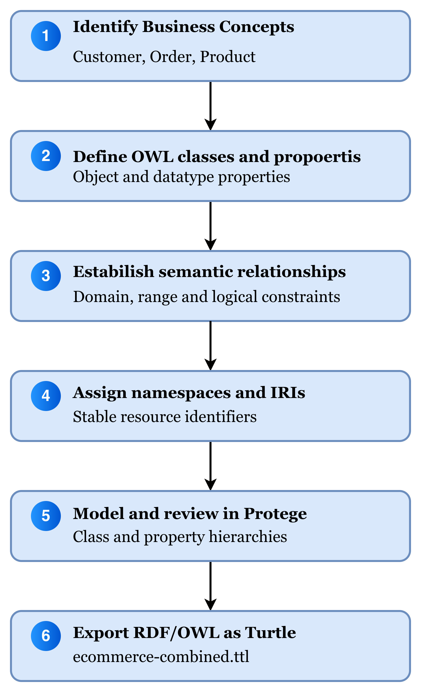
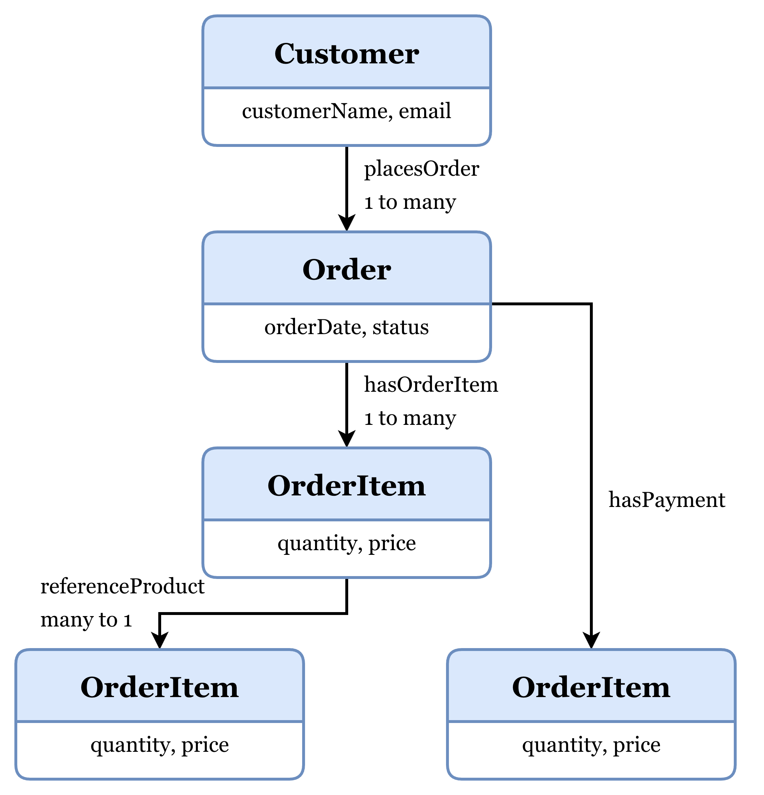
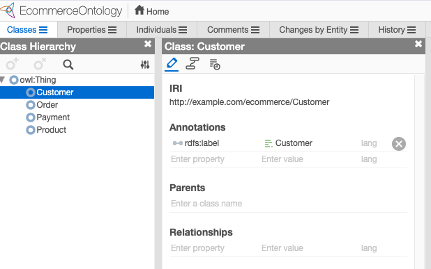
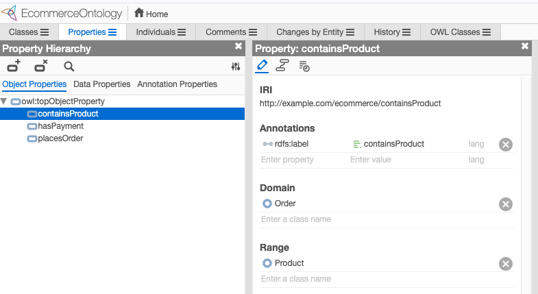
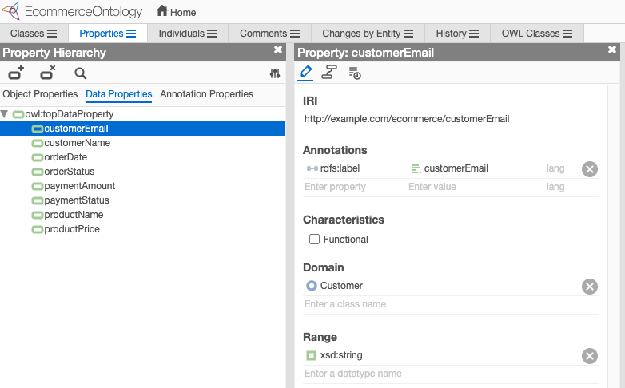
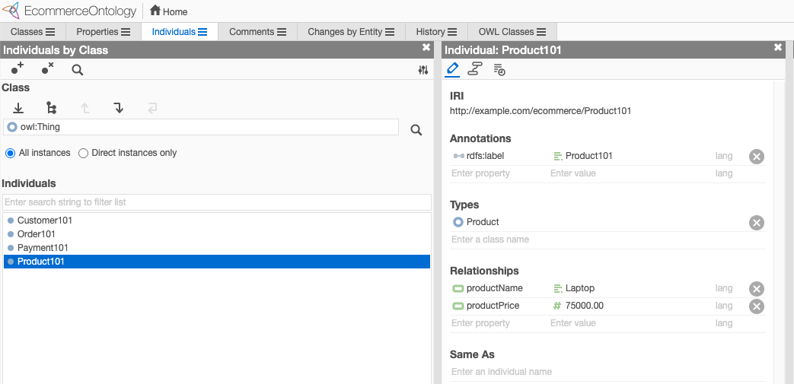

# enterprise-ontology-ecommerce
Enterprise Ontology for ecommence - Minimal implementation

This is a **tutorial starter**, not a production-ready enterprise application. It includes a minimal reference ontology and data. Replace the ontology with your WebProtégé export as appropriate. Python >=3.10 recommended.

Overall flow of this tutorial is:
Model the domain -> Build RDF / OWL ontology -> Validate and test -> Query the knowledge graph -> Deploy to kubernetes -> Consume the semantic layer

# Phase 1 — Local development
## Phase A — Prepare & validate ontology
### Prepare your mac 
```bash
brew install python@3.12 podman kind kubectl
podman machine init
podman machine start
```

### Verify 
```bash
python3.12 --version
podman --version
kind version
kubectl version --client
```

### Set up the Python project
```bash
cd enterprise-ontology-ecommerce
python3.12 -m venv .venv
source .venv/bin/activate
python -m pip install --upgrade pip
python -m pip install -r requirements.txt
```

### Create the Ontology using WebPortege

Use [Webprotege](https://webprotege.stanford.edu/) to create the ontology.  
* This picture illustrates the ontology modeling workflow followed in this tutorial. We begin by identifying business concepts, define the corresponding OWL classes and properties, establish semantic relationships, assign consistent IRIs, and use Protégé to construct and export the ontology. 

* This picture presents the conceptual relationships between the primary e-commerce entities. The model includes customers, orders, order items, products, and payments. OrderItem provides a way to represent product quantities and prices associated with individual purchases. 

* Using Protégé, we create the core domain classes under owl:Thing. The Classes tab provides a hierarchical view of the ontology, allowing us to organize and inspect the business concepts defined in the model.  

* Object properties establish semantic relationships between individuals belonging to different classes. As shown in Figure 5, the placesOrder property connects instances of Customer to instances of Order through its declared domain and range.  

* Datatype properties represent literal attributes associated with ontology individuals.  

* Define data / individuals for the defined relationship.  

### Export the Turtle
Export as Turtle in WebProtégé and save as `ontology/ecommerce-combined.ttl`.

### Inspect the export 

The above script uses RDFLib's local SPARQL engine. You do not need Jena Fuseki to query an RDF file locally.
It resolves object-property IRIs using their labels, which is useful because WebProtégé may assign automatically generated identifiers.

```bash
python scripts/inspect_export.py ontology/ecommerce-combined.ttl
```

Split the export into so that the data is separated.  

```bash
python scripts/split_ontology.py
```

`query_local.py` discovers the **property IRIs** from `rdfs:label`, so WebProtégé-generated opaque IRIs are supported. If you exported only schema with no linked individuals, the query returns no rows. If your export is RDF/XML, export as Turtle or convert with RDFLib first. If your properties do not have the exact labels `placesOrder` and `containsProduct`, adjust the script.

```bash
python scripts/query_local.py ontology/ecommerce-combined.ttl
python scripts/query_local.py ontology/ecommerce.ttl ontology/sample-data.ttl
```


### SHACL validation before application development

You can use  [Open SHACL Graph Editor](https://ulb-darmstadt.github.io/shacl-graph-editor/#/editor) to create ./scripts/ecommerce-shapes.ttl file to define validation rules for your e-commerce data.  For this ecommerce tutorial there are three shapes created:
- CustomerShape — validates customer names and emails.
- ProductShape — validates product names and prices.
- OrderShape — validates order-to-customer relationships.

The following SHACL shape requires every Customer to have a name:
ec:CustomerShape a sh:NodeShape ;
    sh:targetClass ec:Customer ;
    sh:property [
        sh:path ec:customerName ;
        sh:minCount 1 ;
        sh:datatype xsd:string
    ] .

The project contains additional validation constraints for products, orders and payments.

If validation fails, the script reports the relevant constraint violations and exits with a nonzero status.
This is an important enterprise control: invalid RDF data should not automatically be published into the operational knowledge graph.


```bash
python scripts/validate.py
```

**Important**: `shapes/ecommerce-shapes.ttl`, sample data and the FastAPI application use the `http://example.com/ecommerce#` vocabulary. An export with WebProtégé-generated opaque IRIs is not interchangeable. To reuse your export end-to-end, align IRIs in the sample data, SHACL shapes, SPARQL queries and API, or map exported terms to canonical IRIs. Do not simply replace the file and expect canonical queries to work.

### Run automated tests

The included tests check that the required classes and relationships exist and that the sample graph passes SHACL validation. At this stage, you have a working local ontology development workflow without needing any database or Kubernetes cluster. 

```bash
python -m pytest tests/test_project.py -v
```

## Phase B — run Fuseki locally using Podman
### Start Apache Jena Fuseki using Podman

This tutorial uses the community `stain/jena-fuseki` image (not an official Apache-maintained image). For a current enterprise deployment, build a vetted Fuseki image from an Apache release and pin it by digest.

```bash
podman volume create ecommerce-fuseki-data
export FUSEKI_URL="http://localhost:3030"
export FUSEKI_USER="admin"
read -s "FUSEKI_PASSWORD?Enter Fuseki admin password: "
echo
export FUSEKI_PASSWORD
podman run -d --name ecommerce-fuseki -p 3030:3030 -e ADMIN_PASSWORD="$FUSEKI_PASSWORD" -e TDB=2 -v ecommerce-fuseki-data:/fuseki docker.io/stain/jena-fuseki:latest
```

Access the Fuseki UI too - http://localhost:3030/#/; query endpoint: http://localhost:3030/ecommerce/query 
Sign in with username admin and password localpwd.

### Create the datasets 
The provided loader will create a dataset named ecommerce and upload the ontology and sample data into its default graph.

```bash
curl -i -u admin -X POST 'http://localhost:3030/$/datasets' --data-urlencode 'dbName=ecommerce' --data-urlencode 'dbType=tdb2'
```

### Run the Fuseki

```bash
export FUSEKI_DATASET="ecommerce"
python scripts/load_fuseki.py
```

### Verify your ontology using SPARQL
```bash
curl -G -u admin 'http://localhost:3030/ecommerce/query' --data-urlencode 'query=SELECT (COUNT(*) AS ?count) WHERE { ?s ?p ?o }' -H 'Accept: application/sparql-results+json'
```

### Execute a SPARQL query in Fuseki UI

In the Fuseki UI, open the ecommerce dataset and navigate to its query interface. Execute - 

```
PREFIX ec: <http://example.com/ecommerce/>

SELECT ?customer ?order ?product
WHERE {
    ?customer ec:placesOrder ?order .
    ?order ec:containsProduct ?product 
}
```
Response expected - 
```
{
  "head": {
    "vars": [
      "customer",
      "order",
      "product"
    ]
  },
  "results": {
    "bindings": [
      {
        "customer": {
          "type": "uri",
          "value": "http://example.com/ecommerce/Customer101"
        },
        "order": {
          "type": "uri",
          "value": "http://example.com/ecommerce/Order101"
        },
        "product": {
          "type": "uri",
          "value": "http://example.com/ecommerce/Product101"
        }
      }
    ]
  }
}
```

## Phase C — FastAPI locally

### Start the FastAPI application
In a new terminal start the FastAPI application - 

```bash
cd enterprise-ecommerce-ontology
source .venv/bin/activate
uvicorn app.main:app --reload --port 8000
```

Test from another terminal test the responses from ontology

```bash
curl http://localhost:8000/products
curl http://localhost:8000/customers/Customer101/orders
```

At this point, steps involved in running locally is complete.   You have developed, validated, stored and queried your ecommerce ontology locally.

# Phase 2 — Deploy to kind Kubernetes
Now we will deploy the same solution to a local Kubernetes cluster.

## Create the kind cluster
```bash
# First ensure the Podman machine is running.
podman machine start

# For kind, a rootful Podman machine may be required depending on your configuration. If you encounter provider or permission errors, check your Podman machine settings before continuing.
# Set the provider:
export KIND_EXPERIMENTAL_PROVIDER=podman
# Create the cluster:
kind create cluster --name ontology
# Verify: 
kubectl get nodes
```

## Build the FastAPI container
From the project root: 

```bash
podman build -f Dockerfile.api -t localhost/ecommerce-ontology-api:local .
# You should see localhost/ecommerce-ontology-api with tag local.
podman images
```


## Load the image into kind
Similarly to build fuseki

```bash
podman build -f fuseki/Dockerfile -t localhost/fuseki:local ./fuseki
# Test the fuseki locally before deploying to cluster- 
podman run --rm --name fuseki-test -p 3031:3030 localhost/fuseki:local
# In another terminal verify the query
curl -i -G 'http://localhost:3031/ecommerce/query' --data-urlencode 'query=ASK { ?s ?p ?o }'
```

## Deployment to Kubernetes
```bash
podman save -o /tmp/fuseki.tar localhost/fuseki:local
kind load image-archive /tmp/fuseki.tar --name ontology
# This is particularly important with Podman. An image built in your Podman environment is not automatically available inside kind's Kubernetes nodes.
podman save -o /tmp/ecommerce-ontology-api.tar localhost/ecommerce-ontology-api:local
kind load image-archive /tmp/ecommerce-ontology-api.tar --name ontology
# Verify the imported images:
podman exec ontology-control-plane crictl images
```

## Create the required Kubernetes resources
Create secret for Fuseki password.  For a real deployment, use a stronger password and a secrets-management solution. The example value is for this tutorial only.

```bash
read -s "FUSEKI_PASSWORD?Enter Fuseki admin password: "
echo
kubectl create secret generic fuseki-auth --from-literal=ADMIN_PASSWORD="$FUSEKI_PASSWORD"
unset FUSEKI_PASSWORD
```

Deploy the required resources 
```bash
kubectl apply -f k8s/deployment.yaml
# Verify the deployments:  
kubectl get deployments
kubectl get pods
kubectl get svc
```


Just for this tutorial forward to local ports to a pod 
```bash
kubectl port-forward svc/fuseki 3030:3030 
```

Access the SPARQL endpoint - http://localhost:3030/#/dataset/ecommerce/query

## Load ontology to your Kubernetes Fuseki 
Open a new terminal and try - 
```bash
curl -i -G 'http://localhost:3030/ecommerce/query' --data-urlencode 'query=ASK { ?s ?p ?o }'
```

While you can load using load_fuseki.py, you can upload directly using the curl commands like any other production API call.  

```bash
curl -i -X PUT -H 'Content-Type: text/turtle' --data-binary @ontology/ecommerce.ttl 'http://localhost:3030/ecommerce/data?default'
curl -i -X POST -H 'Content-Type: text/turtle' --data-binary @ontology/sample-data.ttl 'http://localhost:3030/ecommerce/data?default'
```

Verify that all 88 triples are present - 
```bash
curl -s -G 'http://localhost:3030/ecommerce/query' --data-urlencode 'query=SELECT (COUNT(*) AS ?count) WHERE { ?s ?p ?o }' -H 'Accept: application/sparql-results+json'
```

## Test customer–order–product relationship
Execute in [Fuseki UI](http://localhost:3030/#/dataset/ecommerce/query) - 

```
PREFIX ec: <http://example.com/ecommerce/>

SELECT ?customer ?order ?product
WHERE {
    ?customer ec:placesOrder ?order .
    ?order ec:containsProduct ?product .
}
```

## Verify the FastAPI application
Execute - 
```bash
kubectl port-forward svc/shop-api 8000:8000
```
In a new terminal test - 
```bash
curl http://localhost:8000/products
curl http://localhost:8000/customers/Customer101/orders
```


